# SkillBytes – Practical Learning Platform

**Team-0510 | SLU MAD Team 8**

<p align="center">
  
</p>

<p align="center">
  <b>A Flutter mobile app for learning practical tech skills in short, focused modules.</b><br/>
  Built with Firebase Auth + Firestore, a custom branded UI, and a full admin dashboard.
</p>

<p align="center">
  🚀 <a href="https://skillbytes-app.onrender.com/"><b>Live Web Demo</b></a>
</p>

---

## 📖 Table of Contents

1. [Project Overview](#1-project-overview)
2. [Problem Statement](#2-problem-statement)
3. [Project Objectives](#3-project-objectives)
4. [Target Users](#4-target-users)
5. [Key Features](#5-key-features)
6. [Technology Stack](#6-technology-stack)
7. [Screenshots](#7-screenshots)
8. [Navigation Flow](#8-navigation-flow)
9. [Setup Instructions](#9-setup-instructions)
10. [Project Structure](#10-project-structure)
11. [Team Members](#11-team-members)
12. [Week-by-Week Development](#12-week-by-week-development)
13. [Repository](#13-repository)
14. [Future Enhancements](#14-future-enhancements)
15. [Conclusion](#15-conclusion)

---

## 1. Project Overview

SkillBytes is a mobile application designed to help learners develop practical technology skills through short, structured learning sessions. The platform focuses on making technical education accessible, beginner-friendly, and easy to follow.

Learners can explore courses in areas such as coding, networking, and electronics, enroll in courses, complete short lessons, and track their learning progress.

## 2. Problem Statement

Many learners struggle to develop technical skills because courses can be lengthy, learning resources are scattered, and beginners often lack a clear learning path. SkillBytes aims to address these challenges through bite-sized lessons, organized course content, and visible progress tracking.

## 3. Project Objectives

- Provide clear learning paths for practical technology topics.
- Organize courses into tracks, modules, and short lessons.
- Enable learners to browse courses and enroll.
- Display learning progress and completed lessons.
- Provide administrators with a simple way to manage learning content.
- Develop a clean and user-friendly mobile application.

## 4. Target Users

**Learners:** Students, beginners, hobbyists, and working professionals who want to improve their technical skills.

**Administrators:** Instructors or content managers responsible for creating, organizing, and updating courses and modules.

## 5. Key Features

### 👤 Learner Features
- Email/password login and registration (Firebase Auth)
- Forgot-password reset flow
- Home dashboard with live data from Firestore
- Course listing with search, category filters, and sort
- Course details with modules and enrollment
- Feedback form with input validation
- Pull-to-refresh for live data
- Dark and light theme support
- Responsive layout (phone, tablet, and web)

### 🛠️ Administrator Features
- Secure admin-only routes (Firestore role check)
- Dashboard with live stats (Courses / Learners / Feedback)
- **Course Management:** create, edit, delete, and import starter courses
- **Learner Management:** searchable list of registered users
- **Feedback Management:** filter, search, and update status (New → Reviewed → Resolved)

## 6. Technology Stack

- **Frontend:** Flutter (Dart)
- **Backend:** Firebase Authentication + Cloud Firestore
- **State Management:** `setState`, `FutureBuilder`, `StreamBuilder`
- **Fonts:** `google_fonts` (Inter)
- **Version Control:** Git + GitHub
- **Wireframing:** Figma / Whimsical
- **Design:** Custom SkillBytes brand palette (berry, orange, gold)
- **Deployment:** Render (live web build)

## 7. Screenshots

### Authentication

<table>
  <tr>
    <td align="center">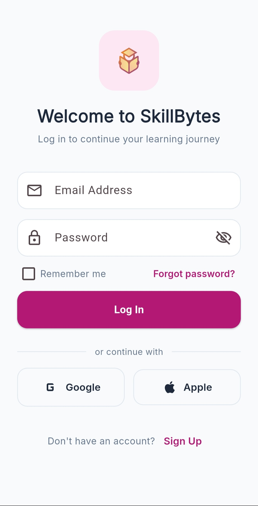<br/><sub><b>Login</b></sub></td>
    <td align="center">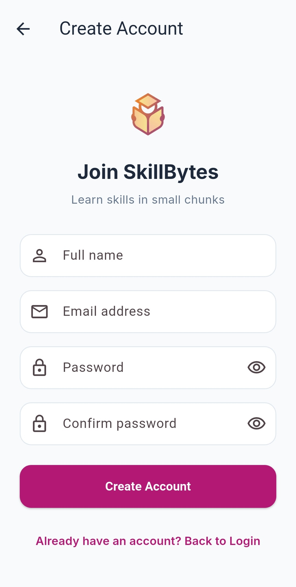<br/><sub><b>Sign Up</b></sub></td>
    <td align="center">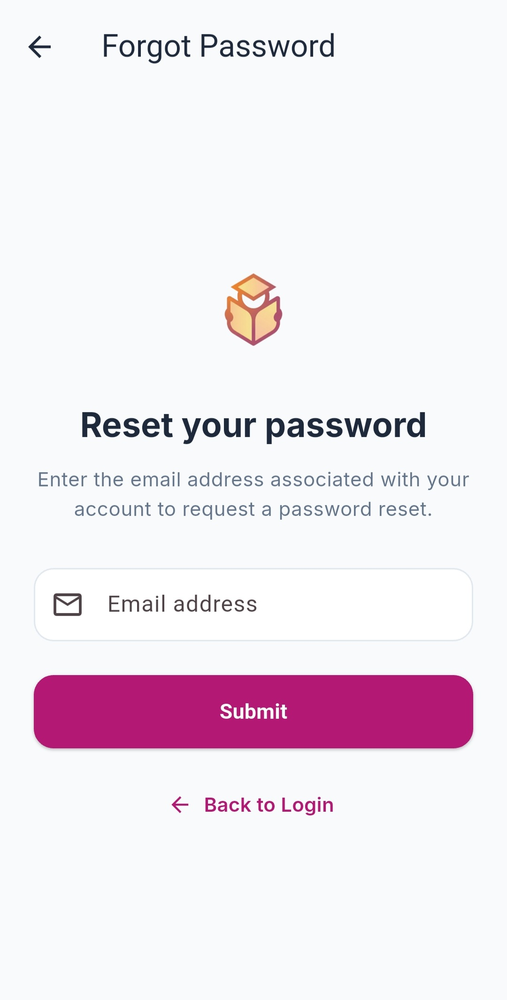<br/><sub><b>Reset Password</b></sub></td>
  </tr>
</table>

### Learner Experience

<table>
  <tr>
    <td align="center">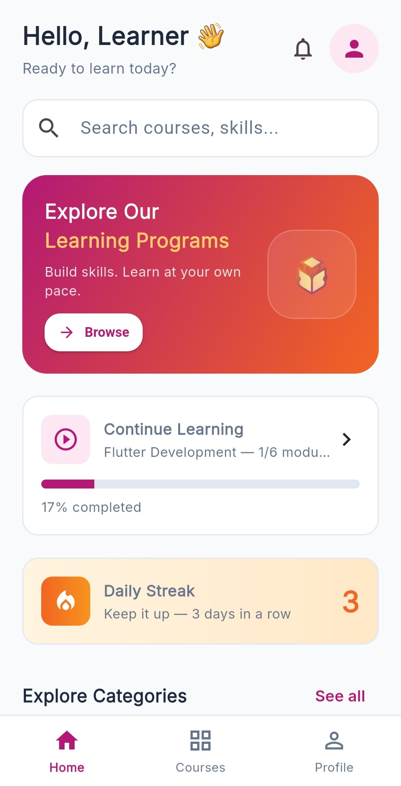<br/><sub><b>Home Dashboard</b></sub></td>
    <td align="center">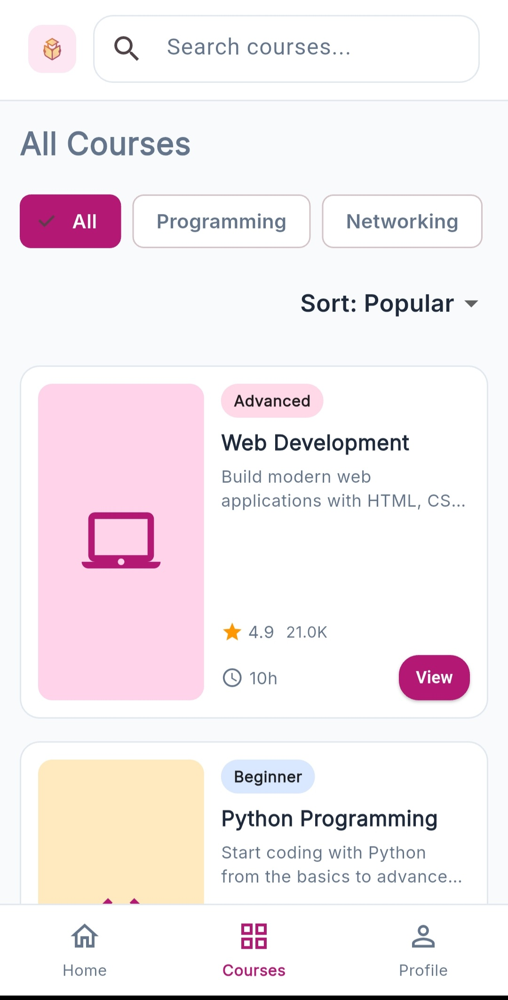<br/><sub><b>Course Listing</b></sub></td>
    <td align="center">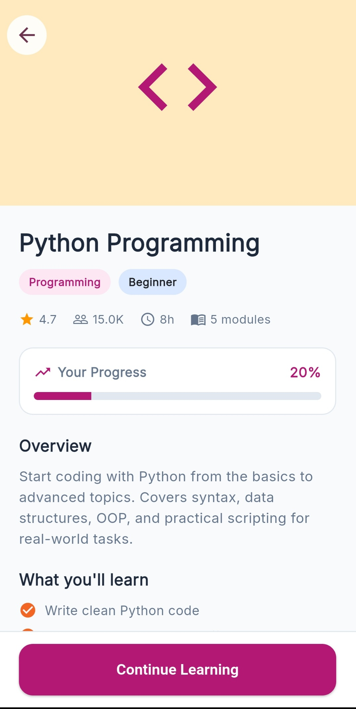<br/><sub><b>Course Details</b></sub></td>
    <td align="center">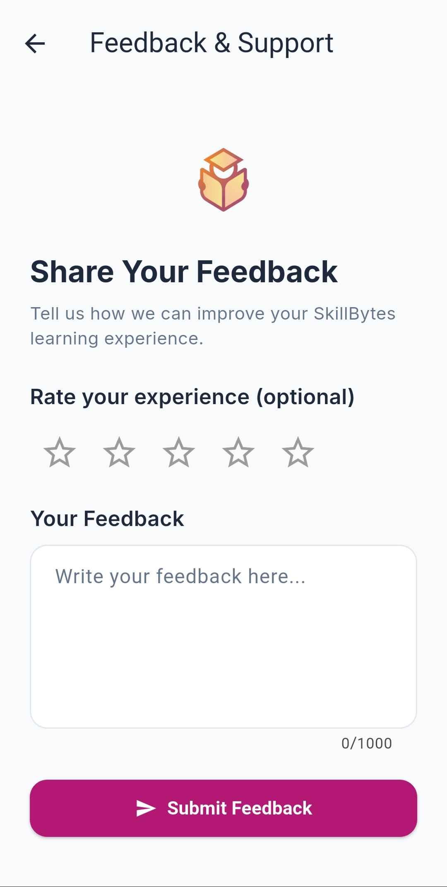<br/><sub><b>Feedback Form</b></sub></td>
  </tr>
</table>

### Administrator Experience

<table>
  <tr>
    <td align="center">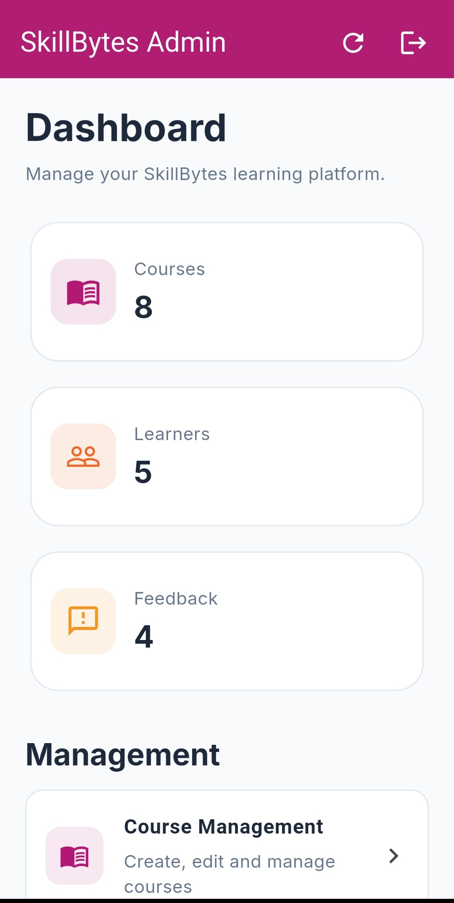<br/><sub><b>Admin Dashboard</b></sub></td>
    <td align="center">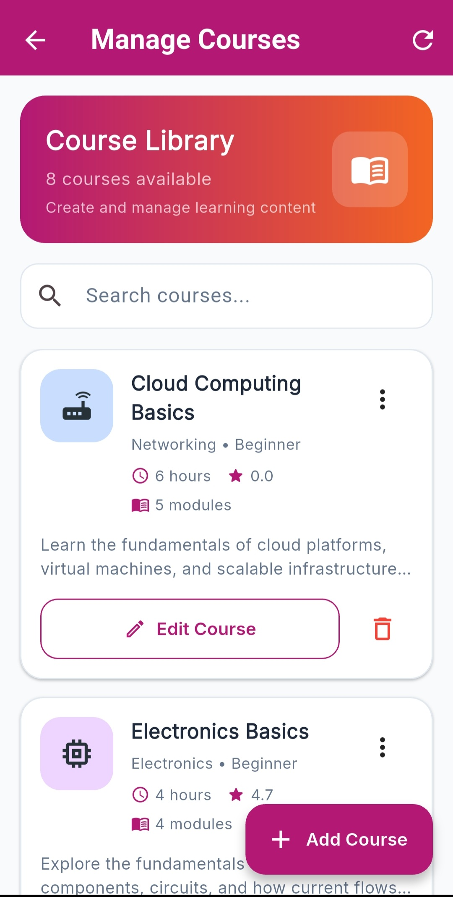<br/><sub><b>Manage Courses</b></sub></td>
    <td align="center">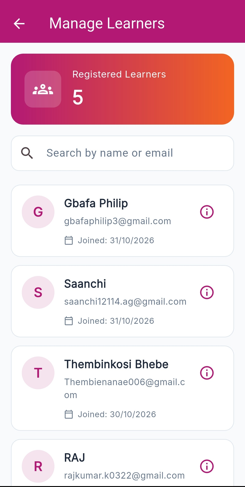<br/><sub><b>Manage Learners</b></sub></td>
    <td align="center">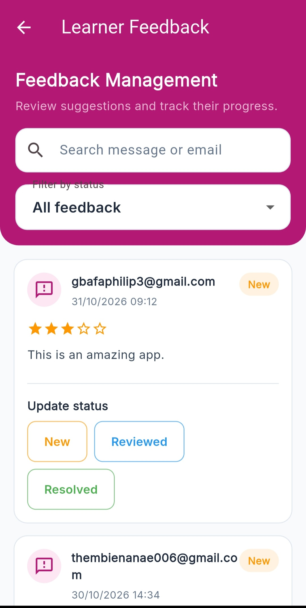<br/><sub><b>Manage Feedback</b></sub></td>
  </tr>
</table>

## 8. Navigation Flow

### Learner
`Login / Sign Up` → `Home` → `Course Listing` → `Course Details` → `Enroll` → `Modules` → `Profile`

### Administrator
`Login` → `Admin Dashboard` → `Manage Courses / Learners / Feedback` → `Add / Edit Course`

## 9. Setup Instructions

### Prerequisites
- Flutter SDK (3.19 or newer)
- A device, emulator, or Chrome (web)
- A Firebase project with **Auth** and **Firestore** enabled

### Steps

```bash
# 1. Clone the repository
git clone https://github.com/RAJ322622/skillbytes_app.git
cd skillbytes_app

# 2. Install dependencies
flutter pub get

# 3. Run the app
flutter run
Firebase Setup (already committed)
android/app/google-services.json is included

lib/firebase_options.dart is included

Firestore Collections Required
Collection	Purpose	How it's populated
courses	Course documents	Auto-seeded via Import Starter Courses in Admin
learners	Registered users	Auto-populated on signup
admins	Admin users' UIDs	Must be added manually in Firestore console
feedback	Learner feedback	Auto-populated when a learner submits feedback
Making a user an Admin
Sign up in the app with the desired admin email

In the Firebase Console, open Firestore → admins

Create a document with the UID as the document ID and { "role": "admin" } as the content

Log out → log in again → the admin dashboard opens automatically

10. Project Structure
text
skillbytes_app/
├── android/
├── assets/
│   ├── data/
│   │   └── courses.json
│   └── images/
│       └── logo.png
├── docs/
├── ios/
├── lib/
│   ├── data/
│   ├── models/
│   ├── screens/
│   │   └── admin/
│   ├── services/
│   ├── state/
│   ├── theme/
│   ├── widgets/
│   ├── firebase_options.dart
│   └── main.dart
├── screenshots/
├── test/
├── web/
├── windows/
├── linux/
├── macos/
├── wireframes/
├── README.md
├── firebase.json
└── pubspec.yaml
11. Team Members
Philip Gbafa – Team Lead

Saanchi Agarwal – Project Lead

Rajkumar A – Co Project Lead

Thembinkosi Bhebe – Project Manager

Sharnice Obeng – Project Scribe

Muhammad Huzaifa Sajjad – Member

Shafiya Anam – Member

12. Week-by-Week Development
📅 Week 1 — Planning & Wireframes
Delivered:

App proposal document

Learner and administrator user journeys

Four low-fidelity wireframes (Login, Home, Course Listing, Course Details)

Initial Flutter project scaffolded

Project README with navigation flow

Contributions:

Philip Gbafa: Wireframes and initial Flutter project

Saanchi Agarwal: Project vision and objectives

Thembinkosi Bhebe: Repository setup and README

Shafiya Anam & Sharnice Obeng: User journey documentation

📅 Week 2 — Working UI Prototype
Delivered:

Four fully interactive Flutter screens: Login, Home, Program Listing, Program Details

Navigator routing across all four screens

Unified ThemeData — colors, typography, styled widgets

Consistent branding across the app

Contributions:

Philip Gbafa: Built the main Flutter screens and Navigator logic

Muhammad Huzaifa Sajjad & Rajkumar A: UI layout, button styling, ThemeData

Saanchi Agarwal: README documentation updates

Shafiya Anam: Demo walkthrough recording

Sharnice Obeng: End-to-end user flow testing, screenshots

📅 Week 3 — Dynamic Data & Forms
Delivered:

JSON-backed data layer — Program Listing and Program Details fetch from assets/data/courses.json via CourseRepository

Feedback form — with real field validation (email format, required fields)

Loading states — CircularProgressIndicator with retry support

Error handling — user-friendly messages with retry actions

Shared UI shell — AppShell with bottom nav (mobile) and sidebar (wide)

Custom brand palette — berry, orange, gold, with custom PNG logo

Contributions:

Philip Gbafa: JSON integration, CourseRepository, brand palette, logo

Rajkumar A: Form UI + validation

Muhammad Huzaifa Sajjad: Loading spinners, error states, retry actions, empty-result handling

Saanchi Agarwal: README updates

Shafiya Anam & Sharnice Obeng: Changelog authoring

Thembinkosi Bhebe: Final reviews and submission management

📅 Week 4 — Firebase Backend & Admin Dashboard
Delivered:

🔥 Firebase Integration

Firebase Authentication — real signup, login, and password reset

Cloud Firestore — courses, learners, and feedback stored and synced in real time

Hybrid data model — the app loads bundled JSON defaults first, then merges Firestore courses on top

🛠️ Admin Dashboard (New)

Role-based access via Firestore admins collection

Live dashboard stats — Courses, Learners, Feedback counts

Course Management: create, edit, delete, and bulk import starter courses

Learner Management: real-time list of registered users with search

Feedback Management: filter, search, and update status

🔄 Pull-to-Refresh & Live Data

Home and Course Listing support pull-to-refresh

Admin changes appear for learners after a single pull-to-refresh

🌐 Live Deployment

Web build deployed at: https://skillbytes-app.onrender.com/

Contributions:

Philip Gbafa: Connected Home to Firestore, pull-to-refresh on Home and Course Listing, finalized brand palette, wrote Week 4 README, recorded demo video

Muhammad Huzaifa Sajjad: Firebase integration (Auth + Firestore), full admin dashboard, admin course/learner/feedback screens, AdminService

Rajkumar A: Form UI refinements and validation polish

Saanchi Agarwal: README review and documentation

Shafiya Anam & Sharnice Obeng: Week 4 documentation

Thembinkosi Bhebe: Final reviews, submission management, Excelerate upload

13. Repository
GitHub: https://github.com/RAJ322622/skillbytes_app

Live Web Demo: https://skillbytes-app.onrender.com/

14. Future Enhancements
Quizzes with scored results

Certificates on course completion

Offline lesson caching

Reminder notifications for streaks

Interactive electronics simulations

Community discussion threads

Push notifications for new courses

Multi-language support

15. Conclusion
SkillBytes makes practical technology learning easier to begin and maintain through short lessons, structured courses, and live progress tracking. Over four weeks, the team went from wireframes to a fully functional, Firebase-backed Flutter application with a polished brand identity, a learner-facing experience, and a complete admin control panel.

The app demonstrates real full-stack behavior — a course added in the admin dashboard is visible to learners after a simple pull-to-refresh — and is deployed as a live web demo alongside the source code.

Thank you to Excelerate and the SLU MAD program for the opportunity.